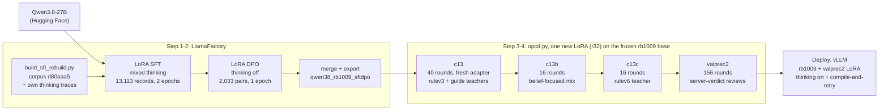
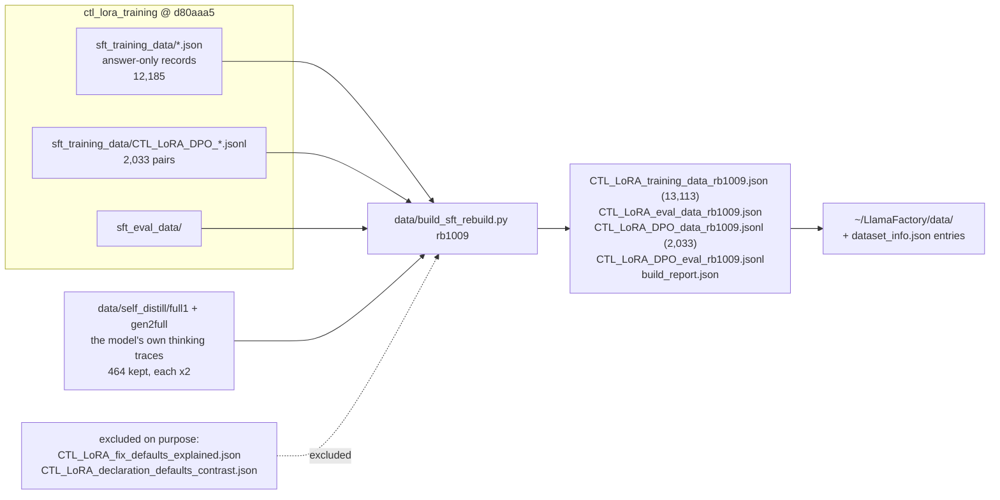
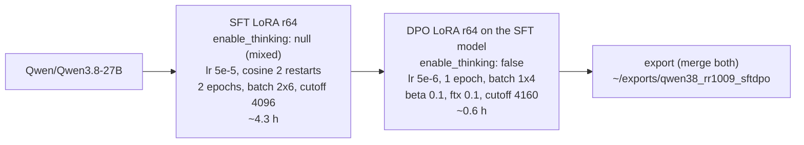
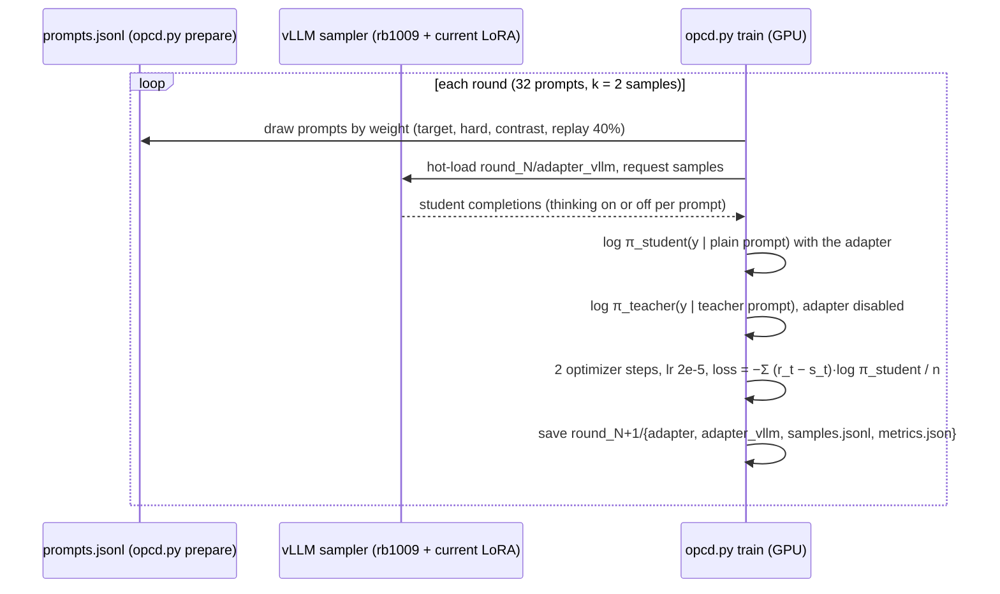
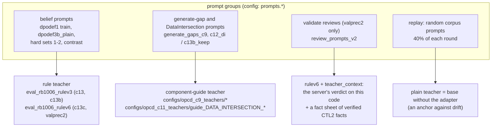
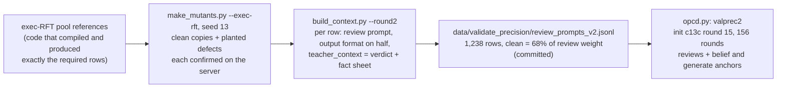
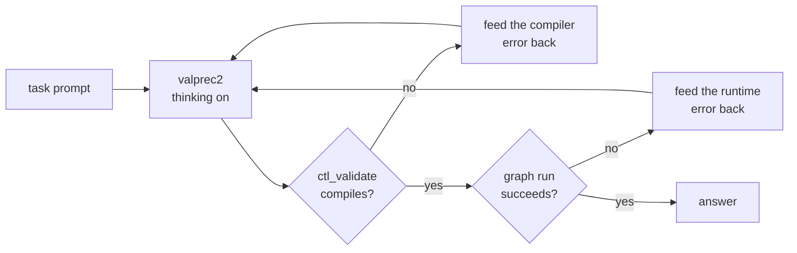

# Rebuilding the CTL2 model from Qwen3.8-27B: a step-by-step how-to

**State as of 2026-11-02. Current model: valprec2.** It is the rb1009 SFT + DPO export plus the OPCD adapter
`data/opcd/valprec2/round_155`.

This document is the recipe for rebuilding today's model from the original Qwen weights. It lists only what is in the
adopted model. Runs that were tried and not adopted are left out; they are in `spec/ctl2_training_findings.md` (§3.x),
and the reasons for each stage are in `spec/training_process_overview.md`.

**Keeping it current:** when a new stage is adopted, add it here (see [Updating this document](#10-updating-this-document)).

## Contents

1. [The model at a glance](#1-the-model-at-a-glance)
2. [Prerequisites](#2-prerequisites)
3. [Step 1 — build the SFT and DPO data](#3-step-1--build-the-sft-and-dpo-data)
4. [Step 2 — SFT + DPO and merge (the rb1009 base)](#4-step-2--sft--dpo-and-merge-the-rb1009-base)
5. [How an OPCD stage works](#5-how-an-opcd-stage-works)
6. [Step 3 — OPCD c13 → c13b → c13c (beliefs, generate gaps, DataIntersection)](#6-step-3--opcd-c13--c13b--c13c)
7. [Step 4 — OPCD valprec2 (validate precision)](#7-step-4--opcd-valprec2-validate-precision)
8. [Step 5 — check the rebuild against the reference numbers](#8-step-5--check-the-rebuild-against-the-reference-numbers)
9. [Step 6 — serve and deploy](#9-step-6--serve-and-deploy)
10. [Updating this document](#10-updating-this-document)
11. [Reproducibility notes and known gaps](#11-reproducibility-notes-and-known-gaps)
12. [File map](#12-file-map)

---

## 1. The model at a glance

| layer | what | how it was trained | artifact |
|---|---|---|---|
| base | Qwen3.8-27B | — (Hugging Face `Qwen/Qwen3.8-27B`) | `~/exports/qwen38_base` → HF cache |
| rb1009 | knowledge of CTL2 and CloverDX components | LoRA SFT (mixed thinking) then LoRA DPO (thinking off), merged into the weights | `~/exports/qwen38_rb1009_sftdpo` |
| c13 → c13b → c13c | correcting pretrained beliefs (declaration defaults, previous-record values), generate gaps per component, DataIntersection in both thinking modes | on-policy context distillation (OPCD), one LoRA continued over three runs: 40 + 16 + 16 rounds | `data/opcd/c13c/round_015` |
| valprec2 | validate precision: fewer false alarms on clean code, higher defect recall | OPCD continued from c13c, 156 rounds, the CloverDX server's verdict in the teacher's context | `data/opcd/valprec2/round_155` |
| deployment | thinking on, compile-and-retry loop | — | vLLM: rb1009 + the valprec2 LoRA |



Two kinds of training serve two purposes, and they are not interchangeable:
- **SFT/DPO (Step 2) adds knowledge the model lacks.** That covers CTL2 syntax, component contracts, and the
  DataIntersection ports.
- **OPCD (Steps 3–4) moves beliefs the model already holds,** which SFT could not change. For example, "an
  uninitialised variable is null" is wrong in CTL2, and OPCD corrects it. OPCD also carries knowledge into the other
  thinking mode.

---

## 2. Prerequisites

### Hardware

- **Two 96 GB GPUs** (the project used NVIDIA RTX PRO 6000 Blackwell, sm_120): one trains, one runs the vLLM sampler for OPCD.
- Step 2 needs one GPU.
- About 250 GB of disk for one rebuild:
  - the HF base (52 GB);
  - one merged export (51 GB);
  - the OPCD run folders, which keep per-round adapters and optimizer states until they are pruned.

### Software

| what | where | notes |
|---|---|---|
| training venv | `~/venv` | torch 2.11 (cu130), transformers 5.2.0, peft 0.18.1, LlamaFactory installed from the fork below. `llamafactory-cli` is in `~/venv/bin` and must be on `PATH`. Do not modify this venv. |
| LlamaFactory | `~/LlamaFactory`, fork `github.com/dpavlis/LlamaFactory` | The `qwen3_8` chat template is upstream (commit 4451765a). The fork's extra commit (`dpo_logps_chunk_size`) is not used by this recipe. |
| vLLM venv | `~/vllm-venv` | vLLM 0.23.0. The serve scripts set `CUDA_HOME=~/cuda-home` and the cu13 library paths. |
| this repository | `~/llama_train` | `opcd.py`, `train.py`, `test.py`, configs, scripts |
| corpus | `~/llama_train/ctl_lora_training` (separate repo, Bitbucket) | Pin it to the commits named in each step. |

### Services

| service | used by | needed for training? |
|---|---|---|
| vLLM sampler (port 3011 or 3013) | OPCD (student samples) | **yes**, Steps 3–4 |
| CloverDX server, `localhost:8083` (`ctl_validate`, graph runs) | execution gates, agent harness, building a new review set | no (only for checks, and for regenerating the valprec2 review set) |
| judge `gpt-6.1-sol` at `127.0.0.1:9001/v1` | `test.py` suite scores | no (only for checks) |

### Conventions on this machine

These are taken from `CLAUDE.md`:
- Check `nvidia-smi` and use free GPUs. Several scripts hard-code GPUs 1 and 3; override or adapt them.
- Launch long jobs from a `#!/bin/bash -l` script with `setsid nohup`. The tool shell does not load `OPENAI_API_KEY`
  or wandb.
- **Use fresh run and export names for a rebuild.** `opcd.py` silently resumes from existing `round_*` folders, and
  `train.py` overwrites `export_dir`. The steps below use the prefix `rr-` (OPCD) and `rr1009` (export).

---

## 3. Step 1 — build the SFT and DPO data



**1.1 Pin the corpus.** Use your own clone of `ctl_lora_training`. On the shared machine, do not move the shared
checkout.

```bash
git -C ctl_lora_training checkout d80aaa5
```

**1.2 Build.** The command writes four files and `build_report.json`:

```bash
cd ~/llama_train && PYTHONPATH=~/LlamaFactory/src ~/venv/bin/python data/build_sft_rebuild.py rb1009 data/sft_rebuild_rr1009 CTL_LoRA_fix_defaults_explained.json CTL_LoRA_declaration_defaults_contrast.json
```

- **SFT:** every answer-only corpus record, plus the self-distilled thinking traces of runs `full1` and `gen2full`, each
  twice. The traces were made by `self_distill.py` from an earlier model of this line, then filtered for format,
  compile, judge and false claims. They are committed and are a frozen input: do not regenerate them.
- **DPO:** every `CTL_LoRA_DPO_*.jsonl` pair.
- **Eval:** copies of `sft_eval_data`. They are used for training loss only.
- **Expected `build_report.json`:** `corpus_commit: ctl_lora_training d80aaa5`, `corpus_records: 12185`,
  `self_distill_kept: 464`, `dpo_pairs: 2033`.

**1.3 Pre-flight.** Run the check in findings §5.1 with `TAG, D = 'rb1009', 'data/sft_rebuild_rr1009'`. Every
"want 0" line must print 0.

**1.4 Register the files with LlamaFactory.**

```bash
cp data/sft_rebuild_rr1009/CTL_LoRA_* ~/LlamaFactory/data/
```

- **On this machine,** `~/LlamaFactory/data/dataset_info.json` already holds the four `*_rb1009` entries. An identical
  `md5sum` against the existing copies means the data was rebuilt exactly.
- **On a new machine,** add the four entries:

```json
"clover_ctl_training_rb1009": {"file_name": "CTL_LoRA_training_data_rb1009.json", "formatting": "sharegpt",
  "columns": {"messages": "messages"},
  "tags": {"role_tag": "role", "content_tag": "content", "user_tag": "user", "assistant_tag": "assistant", "system_tag": "system"}},
"clover_ctl_eval_rb1009": {"file_name": "CTL_LoRA_eval_data_rb1009.json", "formatting": "sharegpt",
  "columns": {"messages": "messages"},
  "tags": {"role_tag": "role", "content_tag": "content", "user_tag": "user", "assistant_tag": "assistant", "system_tag": "system"}},
"clover_dpo_rb1009": {"file_name": "CTL_LoRA_DPO_data_rb1009.jsonl", "ranking": true,
  "columns": {"prompt": "prompt", "system": "system", "chosen": "chosen", "rejected": "rejected"}},
"clover_dpo_eval_rb1009": {"file_name": "CTL_LoRA_DPO_eval_rb1009.jsonl", "ranking": true,
  "columns": {"prompt": "prompt", "system": "system", "chosen": "chosen", "rejected": "rejected"}}
```

---

## 4. Step 2 — SFT + DPO and merge (the rb1009 base)



**2.1 Copy the config with a fresh run name and export path.** The original writes to
`~/exports/qwen38_rb1009_sftdpo`, which is the live base.

```bash
cd ~/llama_train
sed -e 's#^run_name: qwen38-27B-rb1009#run_name: qwen38-27B-rr1009#' \
    -e 's#export_dir: /home/pavlisd/exports/qwen38_rb1009_sftdpo/#export_dir: /home/pavlisd/exports/qwen38_rr1009_sftdpo/#' \
    configs/qwen38_rb1009.yaml > configs/qwen38_rr1009.yaml
```

**2.2 Train and export.** Use a login-shell script. `scripts/rb1009_run.sh` is the template; change its GPU and config
name.

```bash
cd ~/LlamaFactory && export PATH=~/venv/bin:$PATH TMPDIR=~/venv-ds-tmp
CUDA_VISIBLE_DEVICES=<gpu> ~/venv/bin/python ~/llama_train/train.py ~/llama_train/configs/qwen38_rr1009.yaml --skip-post-sft
```

- **Always pass `--skip-post-sft`.** The config still carries the retired phase-3 block (`post_dpo_sft`), and without
  the flag it would run.
- **How the phases run:**
  - `train.py` runs SFT, then DPO on top of the SFT model, then merges both into `export_dir`;
  - the adapters land in `~/LlamaFactory/saves/qwen38-27B-rr1009/<timestamp>_{sft,dpo}/`;
  - `load_best_model_at_end` is off on purpose (findings §4.4): the final checkpoint is used.
- **Expected losses** (rb1009): SFT eval loss about 0.179; DPO eval loss about 0.120, eval reward accuracy about 96%.
- `reasoning_effort: medium` must match between the training and evaluation configs; it does in the shipped configs.

**2.3 Check the base before OPCD** (optional, about half a day):

```bash
setsid nohup scripts/base_eval.sh /home/pavlisd/exports/qwen38_rr1009_sftdpo rr1009 > logs/evals/rr1009_eval.log 2>&1 &
```

Compare the result with the rb1009 column in [Step 5](#8-step-5--check-the-rebuild-against-the-reference-numbers).

---

## 5. How an OPCD stage works

**Design:** one set of weights plays two roles.
- **Student:** the rb1009 export plus a trainable LoRA (r32, all attention and MLP projections), with the plain system
  prompt the model sees in production.
- **Teacher:** the same weights with the adapter **disabled** and a richer prompt. The prompt carries a rule text, a
  component guide, or the CloverDX server's verdict.

**Training signal:** the student samples answers on-policy, and every sampled token is scored by both roles. The update
is the per-token reverse-KL policy gradient, A_t = log π_teacher − log π_student. The student learns to answer, without
the extra context, the way the teacher answers with it.



Which teacher scores a prompt depends on the prompt group:



**Mechanics shared by all four runs:**
- **The teacher and student configs** are the `configs/eval_rb1006_*` files. Despite the name, `opcd.py` takes only the
  system prompt and the tokenizer from them. The tokenizer is identical in the rb1006 and rb1009 exports.
- **Prompt rendering:** prompts are tokenized by `test.py`'s own client code, so they match evaluation byte for byte.
- **Guards:**
  - `quote_guard` drops samples that quote the rule text;
  - `context_guard` (valprec2) drops samples that quote the server verdict;
  - `skip_truncated: ["on"]` skips thinking-on samples cut off at `max_new_tokens`.
- **Commands per run:** `opcd.py prepare`, then `opcd.py train`. `opcd.py smoke` is a 4-prompt sanity check: the KL
  must fall.
- **Probes:** 20 held-out belief prompts are scored every 4 rounds (`probe_*.json`); use them to watch the belief rate.

---

## 6. Step 3 — OPCD c13 → c13b → c13c

The three runs continue one LoRA. Each run's `init_adapter` is the previous run's final round.

| run | init | rounds | teacher for belief prompts | prompt mix (non-replay) | purpose |
|---|---|---|---|---|---|
| c13 | fresh LoRA | 40 | rulev3 | belief prompts (dpodef1 206, dpodef3b 53, hard sets 1 and 2 ×3, contrast 60) + 68 generate-gap prompts ×2 modes + 50 DataIntersection prompts ×2 modes | apply the belief fix on the new base; carry the gap and DI knowledge into both modes |
| c13b | c13 round 39 | 16 | rulev3 | the same belief prompts; gap and DI cut to every third prompt (`c13b_keep.jsonl`, 23 + 17) | c13 diluted the belief prompts and the belief came back; this run focuses on them while keeping the generate gains |
| c13c | c13b round 15 | 16 | **rulev6** = rulev3 + "a value carried from the previous record starts at its default" | as c13b | rulev3 itself failed the previous-record trap (T42 10/20); rulev6 passes (0/20) |

**3.1 Copy the configs under fresh names** and chain them to each other. The sampler name `rb1009_vp` avoids
`run_models.sh`, whose cleanup kills any server named `rb1009`.

```bash
cd ~/llama_train
for s in c13 c13b c13c; do
  sed -e "s/^run: $s\$/run: rr-$s/" \
      -e 's#data/opcd/c13/round_039#data/opcd/rr-c13/round_039#; s#data/opcd/c13b/round_015#data/opcd/rr-c13b/round_015#' \
      -e 's#qwen38_rb1009_sftdpo#qwen38_rr1009_sftdpo#' \
      -e 's#^sampler: .*#sampler: {url: "http://127.0.0.1:3011", served_model: rb1009_vp, concurrency: 32}#' \
      configs/opcd_$s.yaml > configs/opcd_rr-$s.yaml
done
```

**3.2 Start the sampler on the second GPU.** It serves the base. `opcd.py` hot-loads each round's adapter into it, so
`VLLM_ALLOW_RUNTIME_LORA_UPDATING` is set.

```bash
sed 's#qwen38_rb1009_sftdpo#qwen38_rr1009_sftdpo#' scripts/validate_precision/vllm_sampler_3011.sh > logs/evals/vllm_sampler_rr.sh
GPU=<sampler gpu> PORT=3011 setsid nohup bash -l logs/evals/vllm_sampler_rr.sh > logs/evals/vllm_sampler_rr.log 2>&1 &
until curl -sf 127.0.0.1:3011/v1/models | grep -q rb1009_vp; do sleep 10; done
```

**3.3 Prepare and train each run in order.** Run each one to its last round before preparing the next, because the
next run's `init_adapter` must exist.

```bash
for s in rr-c13 rr-c13b rr-c13c; do
  ~/venv/bin/python -u opcd.py prepare --config configs/opcd_$s.yaml > logs/evals/opcd_${s}_prepare.log 2>&1 &&
  CUDA_VISIBLE_DEVICES=<train gpu> ~/venv/bin/python -u opcd.py train --config configs/opcd_$s.yaml > logs/evals/opcd_${s}_train.log 2>&1 || break
done
```

Wrap the loop in a `#!/bin/bash -l` script (`scripts/opcd_difr2_run.sh` is a template). Durations on one training GPU:
c13 about 5 h, c13b about 1 h, c13c about 1 h.

**Inputs these configs read** (all in git unless noted):

| input | role |
|---|---|
| `data/self_distill/dpodef1/prompts.jsonl` (split train / probe) | 206 belief-prone fix / validate prompts and the 20 probe prompts |
| `data/self_distill/dpodef3b_plain/prompts.jsonl` | 53 declaration-contrast prompts |
| `data/opcd/hard_cases.jsonl`, `hard_cases2.jsonl` | hard sets 1 (belief traps) and 2 (previous-record dates) |
| `data/opcd/contrast_prompts.jsonl` | 60 corpus prompts where something really is null, against over-correction |
| `data/opcd/generate_gaps_c9.jsonl`, `data/opcd/c12_di.jsonl` | c13: 68 generate-gap prompts (each names its guide teacher), 50 DataIntersection prompts |
| `data/opcd/c13b_keep.jsonl` | c13b / c13c: every third gap and DI prompt |
| `data/opcd/hard_holdout_c13.json` | holdouts excluded from training |
| `configs/eval_rb1006_{on,off}.yaml` | student system prompt and tokenizer |
| `configs/eval_rb1006_rulev3_*.yaml`, `eval_rb1006_rulev6_*.yaml` | rule teachers |
| `configs/opcd_c9_teachers/*`, `configs/opcd_c11_teachers/guide_DATA_INTERSECTION_*` | component-guide teachers |
| corpus `ctl_lora_training` @ d80aaa5 | the replay pool, drawn at `prepare` |

---

## 7. Step 4 — OPCD valprec2 (validate precision)

valprec2 continues c13c on code reviews. The teacher is told what the CloverDX server said about the reviewed code. The
student, without that context, learns not to raise false alarms on code that runs, and to find the defects that make
code fail.



**4.1 The review set is committed:** `data/validate_precision/review_prompts_v2.jsonl` and its `.report.json`. Use it as
is. Regenerating it (`scripts/validate_precision/make_review_set.sh`, then `build_context.py --round2`) needs the
CloverDX server and the exec-RFT pool. Its anchors are `data/validate_precision/c13b_keep_no_holdout.jsonl` (c13b_keep
minus three holdout prompts), plus the belief prompts and hard sets of Step 3 at higher weights, which keep reviews
about 63% of the non-replay weight.

**4.2 Copy the config and train.** The sampler from Step 3 keeps running.

```bash
sed -e 's/^run: valprec2$/run: rr-valprec2/' \
    -e 's#data/opcd/c13c/round_015#data/opcd/rr-c13c/round_015#' \
    -e 's#qwen38_rb1009_sftdpo#qwen38_rr1009_sftdpo#' \
    -e 's#^sampler: .*#sampler: {url: "http://127.0.0.1:3011", served_model: rb1009_vp, concurrency: 32}#' \
    configs/opcd_valprec2.yaml > configs/opcd_rr-valprec2.yaml
~/venv/bin/python -u opcd.py prepare --config configs/opcd_rr-valprec2.yaml
CUDA_VISIBLE_DEVICES=<train gpu> ~/venv/bin/python -u opcd.py train --config configs/opcd_rr-valprec2.yaml
```

- **Corpus pin:** the original valprec2 was prepared with the corpus at `23f616f`, which matters only for the replay
  draw. To reproduce it exactly, check that commit out before `prepare`; d80aaa5 gives a statistically equivalent
  replay set.
- **Duration:** about 17 h. In `metrics.json`, the KL of the clean / plain / thinking-off review slot should converge,
  from about 0.17 to about 0.005.
- **Result:** `data/opcd/rr-valprec2/round_155/{adapter, adapter_vllm}`.

**4.3 Prune the run folders** once the final round is chosen. `optimizer.pt` and the other rounds' adapters are only
needed to resume. Add the final rounds to `KEEP_ROUNDS` in `scripts/cleanup_lifecycle.sh` and run it.

---

## 8. Step 5 — check the rebuild against the reference numbers

A rebuild will not match these numbers exactly. Rebuild-to-rebuild seed variance is about ±0.06–0.07 on validate and
the gap tests (findings §4.7), so judge a rebuild by whether it lands inside those bands.

**How to measure:**
- Use the vLLM path only (`test.py` with `mut.mode: vllm`), and one judge.
- Rank generate by the execution pass rate (`data/suite_v5/exec_score.py`), not by the judge score.
- Gate validate on the planted-defect ground truth (findings §4.8).

| gate | script | rb1009 | c13c | valprec2 |
|---|---|---|---|---|
| T53 DataIntersection, off / on | `scripts/base_eval.sh` / `scripts/validate_precision/gates.sh` | 1.00 / 0.75 | 1.00 / 1.00 | — |
| T40 + T42 belief traps below full score (n20 each) | same | 40/40 | 8/40 | as c13c |
| hard sets 1 / 2 / 3, belief claims | `data/opcd/eval_hard_cases.py` | 74% / 92% / 0% | 0 / 0 / 0 | 0 / 0 / 0 |
| suite v5 gap tests, execution pass rate, off / on | `gates.sh` (gaps) | — | 0.403 / 0.761 | 0.382 / 0.736 |
| agentic harness, fresh-domain pool_tweak, first attempt, off / on | `scripts/validate_precision/harness_tweak.sh` | — | 0.721 / 0.812 | 0.730 / 0.815 |
| B1-tweak validate, format, thinking off: false alarm / recall | `gates.sh` (gt); `scripts/harness_measurement/{gen_answers.py --format, score_validate.py}` | — | 0.24 / 0.80 | 0.15 / 0.88 |
| B1 validate, format, thinking on: false alarm / recall | same | — | 0.14 / 0.86 | 0.03 / 0.96 |

**Commands:**

```bash
# base (after Step 2)
setsid nohup scripts/base_eval.sh /home/pavlisd/exports/qwen38_rr1009_sftdpo rr1009 > logs/evals/rr1009_eval.log 2>&1 &
# final model (after Step 4): thinking-off on the sampler (:3011, still running), thinking-on on an eval server (:3012)
sed -e 's#qwen38_rb1009_sftdpo#qwen38_rr1009_sftdpo#' -e 's#--served-model-name rb1009 #--served-model-name rb1009_vpe #' \
    -e 's#CUDA_VISIBLE_DEVICES=1 #CUDA_VISIBLE_DEVICES=<gpu> #' scripts/vllm_eval_serve_rb1009.sh > logs/evals/vllm_eval_rr.sh
setsid nohup bash -l logs/evals/vllm_eval_rr.sh > logs/evals/vllm_eval_rr.log 2>&1 &
SPORT=3011 PLAIN_MODES="off on" setsid nohup scripts/validate_precision/gates.sh rr-valprec2 155 > logs/validate_precision/gates_rr.log 2>&1 &
RUN=rr-valprec2 LAST=155 GPU=<gpu> setsid nohup scripts/validate_precision/harness_tweak.sh > logs/validate_precision/harness_rr.log 2>&1 &
```

`gates.sh` and `harness_tweak.sh` need the CloverDX server (localhost:8083, sandbox `MiscExamples`) and the judge.
Check that each evaluation log shows `Verdict:` lines.

---

## 9. Step 6 — serve and deploy

**Serving:** serve the base with the LoRA. Alternatively, `opcd.py export --config configs/opcd_rr-valprec2.yaml
--round 155 --out ~/exports/<name>` merges the adapter into a full HF model.

**Merged export for deployment (2026-11-03): `~/exports/qwen38_ctl2_deploy_valprec2`**, built by
`scripts/export_deploy_valprec2.sh`. It is the base below with the valprec2 adapter merged in, so serve it with
`--model ~/exports/qwen38_ctl2_deploy_valprec2` and without the `--enable-lora` / `--lora-modules` flags. Note that
`opcd.py export` loads the text model only and writes a `Qwen3_5TextConfig`, which vLLM rejects; the script's
follow-up copies the base `config.json` and the 333 untouched `model.visual.*` tensors (`model-visual.safetensors`)
back in. The folder's `README.md` and `system_prompt.txt` carry the request settings of this table.

```bash
~/vllm-venv/bin/python3 -m vllm.entrypoints.openai.api_server --host 127.0.0.1 --port 3012 \
  --model /home/pavlisd/exports/qwen38_rb1009_sftdpo --served-model-name rb1009 --dtype bfloat16 \
  --max-model-len 16384 --enable-prefix-caching --enable-lora --max-lora-rank 32 \
  --lora-modules valprec2=/home/pavlisd/llama_train/data/opcd/valprec2/round_155/adapter_vllm
```

The environment variables are the ones `scripts/vllm_eval_serve_rb1009.sh` sets.

**Request settings** (the ones the model was trained and measured with):

| setting | value |
|---|---|
| system prompt | `inference.system_prompt` in `configs/eval_rb1006_on.yaml` (same text in `_off`), **followed by `data/sysprompt/deploy_v1.txt`** (seven CTL2 rule lines + the DataIntersection join-like paragraph; decided 2026-11-03, WORKLOG). The combined text is in `configs/eval_sp_v5gaps_valprec2_deploy_on.yaml`. Thinking on, paired on 165 fresh-domain tasks: first attempt 0.815 → 0.918, DataIntersection 76 → 102/102, residual gap tests 64 → 85/120, validate recall and false alarm unchanged. |
| thinking | **on**: `chat_template_kwargs: {"enable_thinking": true, "reasoning_effort": "medium"}` |
| sampling | temperature 0.4, top_p 0.95 |
| max tokens | 16384 |

**Deployment loop:** compile-and-retry. Validate the generated graph with `ctl_validate`, run it, and on an error send
the server's message back as the next user turn. Up to 2 rounds, as `agent_harness.py run --rounds 2` does.



With this loop, c13c passed 88% of 137 execution-scored tasks thinking on (§3.31), and 86% of the 165 fresh-domain
tasks (§3.36). valprec2 matches c13c on generate (pool_tweak after feedback 0.882 vs 0.858 thinking on).

---

## 10. Updating this document

When a new training stage is **adopted** (a WORKLOG decision, findings §3.x marked adopted):

1. **Steps:** add it after the last one, with the config, the `init_adapter` / base it continues, the inputs, the
   duration and the gates it passed.
2. **Diagram:** extend the lineage diagram in §1 and the table above it.
3. **Reference numbers:** add a column for the new model to §8, and retire the oldest column when it is no longer
   compared against.
4. **Header and §9:** change the "Current model" line and the serving command.
5. **Gaps:** if the stage needs an input that is not in git, list it in §11 until it is.
6. **New base:** if the stage changes the SFT/DPO base (a new rebuild rbNNNN), replace Steps 1–2. Re-run the OPCD
   chain on the new base, either as here or with `scripts/opcd_stage3.sh`, and state which.

Runs that were not adopted stay out of this document. Their record is in the findings and the WORKLOG.

---

## 11. Reproducibility notes and known gaps

- **Inputs in git:** every input the OPCD configs read is committed. The last two were
  `data/self_distill/dpodef1/prompts.jsonl` and `dpodef3b_plain/prompts.jsonl` (2026-11-02). The other files in those
  run folders (samples, judgements) are not needed for a rebuild.
- **The self-distilled traces are a frozen input.** The models that produced them, from the retired fix6 line, no
  longer exist. Rebuild from the committed `data/self_distill/{full1,gen2full}/selfdistill_*_train.json`.
- **Exact bit-for-bit reproduction is not expected.** Seeds are fixed (SFT seed 42, OPCD seed 0). However, vLLM
  sampling and GPU kernels are not deterministic, so check against the §8 bands.
- **The eval-config names are historical.** `configs/eval_rb1006_*` point at `~/exports/qwen38_rb1006_on` and similar
  symlinks to the rb1006 export, and `opcd.py` uses them only for the system prompt and tokenizer. On a machine without
  rb1006, set their `model_path` to the rb1009 export, whose `tokenizer.json` is identical.
- **Corpus commits:** d80aaa5 for Steps 1–3; 23f616f was current at valprec2's `prepare`, and it affects only the
  replay draw.
- **LlamaFactory:** the fork is one commit ahead of its GitHub remote (`dpo_logps_chunk_size`, not used here), and it
  has an uncommitted DDP-only eval change. Neither matters on one GPU.
- **Hard-coded GPUs:** many scripts default to GPUs 1 and 3; override them (`GPU=`, `TGPU=`, `CUDA_VISIBLE_DEVICES`).
- **Run artifacts are not in git:** exports, `~/LlamaFactory/saves`, `data/opcd/<run>/`, `results/` and `logs/`. Only
  configs, scripts, specs and inputs are.

---

## 12. File map

| step | file | what it is |
|---|---|---|
| 1 | `data/build_sft_rebuild.py` | builds SFT / DPO / eval files for a tag; header documents the composition |
| 1 | `data/self_distill/{full1,gen2full}/selfdistill_*_train.json`, `data/self_distill/sd_stale.json` | own thinking traces and the stale-trace exclusion list |
| 1 | findings §5.1 | corpus pre-flight snippet |
| 2 | `configs/qwen38_rb1009.yaml` | SFT + DPO + export config (LlamaFactory keys) |
| 2 | `train.py`, `scripts/rb1009_run.sh` | phase runner (SFT → DPO → export); launch template |
| 2 | `scripts/base_eval.sh` | gates for a new base export |
| 3–4 | `opcd.py` | OPCD: `prepare`, `smoke`, `train`, `export` |
| 3 | `configs/opcd_c13.yaml`, `opcd_c13b.yaml`, `opcd_c13c.yaml` | the three chained runs |
| 4 | `configs/opcd_valprec2.yaml` | validate-precision run |
| 4 | `data/validate_precision/review_prompts_v2.jsonl`, `c13b_keep_no_holdout.jsonl` | review prompts with teacher contexts; generate anchors |
| 4 | `scripts/validate_precision/{make_review_set.sh, build_context.py}` | how the review set was made |
| 3–4 | `scripts/validate_precision/vllm_sampler_3011.sh` | OPCD sampler (`GPU`, `PORT`, `NAME`) |
| 5 | `scripts/validate_precision/{run.sh, gates.sh, harness_tweak.sh}` | full gates and the fresh-domain harness |
| 5 | `data/suite_v5/exec_score.py`, `data/opcd/eval_hard_cases.py`, `test.py` | execution scoring, hard sets, suite |
| 6 | `agent_harness.py`, `data/suite_v5/exec_retry.py` | the compile-and-retry loop |
| — | `scripts/cleanup_lifecycle.sh` | prune weights and optimizer states after a run |
| — | `spec/ctl2_training_findings.md`, `spec/training_process_overview.md`, `WORKLOG.md` | why each step exists, numbers, history |
