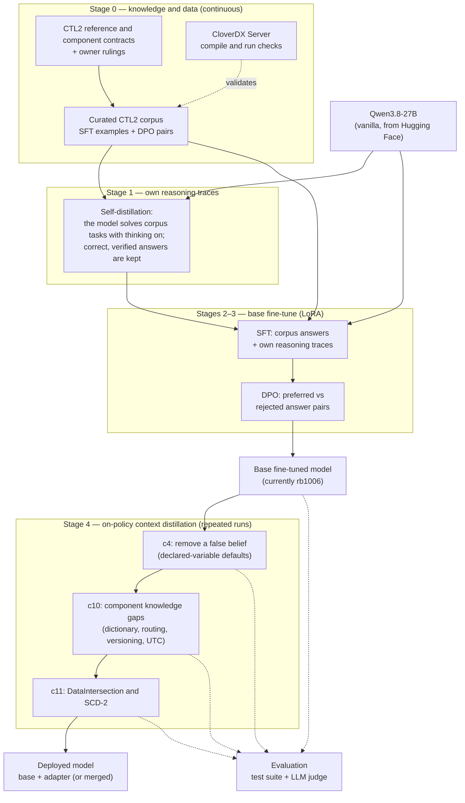
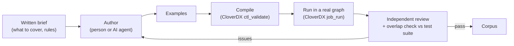
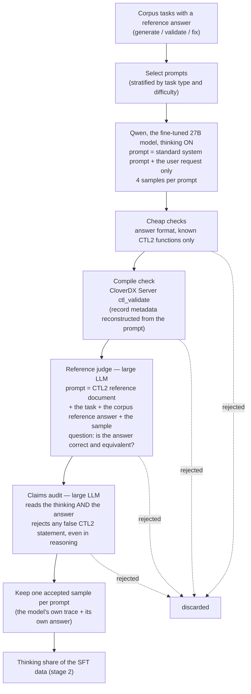
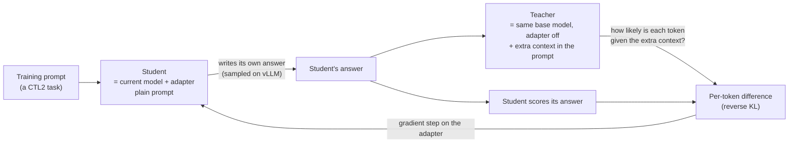

# How the CTL2 model is trained: an overview

This document explains, for someone new to the project, how a general-purpose open model (Qwen3.8-27B) is turned
into a model that writes, reviews and fixes CTL2 code for CloverDX reliably. It describes the stages, the training
technique used in each, the data each needs and where that data comes from, the external resources involved, and how
results are measured.

For measured results, the history of what was tried and why, and the owner's rulings on CTL2 semantics, see
`spec/ctl2_training_findings.md` (the project's lab notebook).

## Contents

1. [The goal](#1-the-goal)
2. [The pipeline at a glance](#2-the-pipeline-at-a-glance)
3. [Stage 0: knowledge and training data](#3-stage-0-knowledge-and-training-data)
4. [Stage 1: self-distilled reasoning traces](#4-stage-1-self-distilled-reasoning-traces)
5. [Stage 2: supervised fine-tuning (SFT)](#5-stage-2-supervised-fine-tuning-sft)
6. [Stage 3: preference optimisation (DPO)](#6-stage-3-preference-optimisation-dpo)
7. [Stage 4: on-policy context distillation (OPCD)](#7-stage-4-on-policy-context-distillation-opcd)
8. [Evaluation: how a model is judged](#8-evaluation-how-a-model-is-judged)
9. [Where we are today](#9-where-we-are-today)
10. [Next steps](#10-next-steps)
11. [Deployment](#11-deployment)
12. [External resources](#12-external-resources)
13. [Data groups and where they come from](#13-data-groups-and-where-they-come-from)
14. [What did not work, and why it matters](#14-what-did-not-work-and-why-it-matters)
15. [Glossary](#15-glossary)

---

## 1. The goal

CTL2 (Clover Transformation Language) is the scripting language of CloverDX data-integration graphs. It is a
niche language: a general model knows little of it and confidently mixes it up with Java, JavaScript or SQL. It
also does not know the contracts of CloverDX components: which functions a component calls, what return values mean,
which ports exist.

The target model handles three kinds of task, used by a developer agent that builds and maintains CloverDX graphs:

| task | what the model does |
|---|---|
| **generate** | write the CTL2 for one component from a business specification and the record metadata |
| **validate** | review given CTL2 and list the real defects, without inventing false ones |
| **fix** | repair given CTL2 so it meets a stated specification |

Qwen3.8 is a reasoning model: it can "think" (produce a hidden reasoning trace) before answering, or answer
directly. Both modes are trained and measured, because they behave differently: thinking helps fix and complex
generation; answering directly is more reliable for validate.

## 2. The pipeline at a glance



**Every stage trains a LoRA adapter, not the full model.** A LoRA adapter is a small set of extra weights, a few
hundred MB, added on top of the frozen 27B base. It is cheap to train, can be swapped or merged, and limits how far
training can push the model.

**Stage 4 runs on top of the result of stages 2–3.** Its adapters are trained on the merged base model.

**Approximate cost on this setup** (one 96 GB GPU per job):
- self-distillation: a few hours;
- SFT + DPO: several hours to a day;
- one OPCD run: 3.5–5 h of training plus 1–2 h of evaluation;
- a full evaluation of one model: about 30–60 min.

## 3. Stage 0: knowledge and training data

Everything downstream depends on correct knowledge of CTL2. This stage is continuous work, not a one-off.

### 3.1 The reference

- **The CTL2 reference**
  - A single document with the language, the built-in functions, component patterns, common pitfalls, and facts
    verified by running graphs on a real server (e.g. "`str2decimal("")` throws", "`dateAdd(d, -1, day)` shifts by
    an hour across a DST change").
  - It is also given to the judge model during evaluation.
- **Component contracts**
  - What each CloverDX component (Reformat, Rollup, Normalizer, DataIntersection, …) calls in CTL2, what its return
    values mean, and which ports it writes.
  - The official component guides on the CloverDX Server supplement them.
- **Owner rulings**
  - Where the language or the documentation is ambiguous, the project owner decides what counts as correct, and the
    ruling is recorded.
  - Examples:
    - "declared variables start at their type's default, not null";
    - "`STOP` aborts the graph";
    - "DataIntersection CTL writes `$out.0`, which leaves on port 1".

### 3.2 The curated corpus

Training examples are written by people and by AI agents working from written briefs, and checked before use:

- **SFT examples:** a user request (often with record metadata) and a correct answer. They cover generate, validate,
  fix and explanation tasks, organised in topic sets: functions, components, dates, decimals, lookups, error
  handling, fix-to-spec, and so on.
- **DPO pairs:** one request with two answers that differ in one point, one preferred and one rejected (e.g. the
  correct port vs a wrong one).
- **Validation before an example is accepted:**
  - every CTL block is compiled on the CloverDX Server;
  - for newer sets, every generated answer is also *run* in a real graph on test records and its output compared with
    the expected output;
  - an independent reviewer checks a sample;
  - overlap with the test suite is checked, so training never leaks the exam.



## 4. Stage 1: self-distilled reasoning traces

### 4.1 Why

The corpus answers are "answer-only": they show the correct result, not the reasoning that leads to it. A reasoning
model must also be trained on *thinking*, but whose thinking?

**What went wrong first.** Early in the project, reasoning traces written by people or by other models were added to
the training data. That damaged the model's own reasoning:
- thinking became short and formulaic;
- it stopped scaling with task difficulty (2.5× longer on hard tasks than easy ones, against 6× before);
- self-checking ("wait", "let me verify") disappeared;
- fix accuracy fell by half.

The traces were well written; the problem was that they were not the model's own way of reasoning.

**Self-distillation** solves this. The model generates its own reasoning, and only the cases where that reasoning
led to a correct answer are kept. Training on them reinforces the model's own good reasoning instead of replacing it.

### 4.2 How it is done



**Two models with very different prompts:**

| role | model | what it gets in its prompt |
|---|---|---|
| **generator** | Qwen3.8-27B after SFT + DPO (the model being improved) | **exactly what it gets in deployment:** the standard CloverDX-expert system prompt and the user's request. No reference answer, no CTL2 documentation, no hints. Otherwise the traces would depend on information the model never has at use time. |
| **judge and auditor** | a large frontier LLM (run locally) | **a large prompt** of about 25–30 thousand tokens: the full CTL2 reference document, the task, the corpus's verified reference answer, and the sample. The large model with the reference is what makes the filter reliable; Qwen alone could not judge its own reasoning. |

**Details that matter:**
- **Several samples per prompt** (k=4) at the deployment sampling settings. Tasks the model sometimes solves give
  usable traces; tasks it never solves (0 of 4) are recorded as gaps for other stages, not forced.
- **The claims audit reads the reasoning too.** A correct answer reached through a false belief in the thinking would
  teach that belief, so such samples are rejected. In the pilot this removed about one in five judge-accepted
  samples.
- **A second, independent judge pass** on a random subset checks the first judge.
- **Yield:** about 30–40% of samples are accepted (fix 41%, generate 39%, validate 27% in the first full run). Two
  generation rounds kept 464 traces.
- **Use in stage 2:** the kept traces are added to the SFT data, each twice, alongside the answer-only corpus.

**Data:** prompts and reference answers from the curated corpus (the tasks that name a component and generate, validate
or fix CTL2). The test suite is excluded.

**Needs:**
- a GPU with the fine-tuned model, for generation;
- the CloverDX Server, for compile checks;
- the judge LLM endpoint, for the reference judge and the claims audit;
- the CTL2 reference document.

## 5. Stage 2: supervised fine-tuning (SFT)

**Technique.** Standard supervised fine-tuning with LoRA (rank 64), using the LlamaFactory framework. The model learns
to reproduce the target answer token by token.

**Data:**
- all answer-only corpus examples (about 12,000);
- the self-distilled traces from stage 1, each included twice.

The answer-only examples are trained with an empty thinking block, so the model keeps both modes.

**Settings:** two epochs, context up to 4,096 tokens.

**Result:** the model knows CTL2 syntax, functions and the common component patterns.

## 6. Stage 3: preference optimisation (DPO)

**Technique.** Direct Preference Optimization: given a preferred and a rejected answer to the same request, the model
is pushed to make the preferred one more likely than the rejected one. This sharpens choices the SFT stage left
uncertain (the right port, the right function, a correct vs an invented defect).

**Data:** about 2,000 DPO pairs from the corpus.

**Settings:** one epoch, thinking off, a small learning rate. The adapter is then merged into the base weights.

**Result:** the base fine-tuned model, currently called **rb1006**.

**Limit.** Offline DPO did not remove beliefs that the pretrained model holds strongly. That is why stage 4 exists.

## 7. Stage 4: on-policy context distillation (OPCD)

### 7.1 The idea

Some errors survive any amount of example data. The clearest case: the pretrained model "knows" from Java and other
languages that an uninitialised variable is null, while in CTL2 it starts at a default (0, "" and so on). It then
writes `if (prev == null)` checks that never fire, a real bug. Adding correct examples did not change this.

What *does* fix it is telling the model the rule in its prompt. OPCD turns "the model with the rule in its prompt"
into "the model without it":



- The **student** answers in its own words: this is what *on-policy* means. It never trains on someone else's text,
  which is what broke reasoning in stage 1.
- The **teacher** is the same model with extra context in its prompt. It rates every token of the student's
  answer. Where the teacher with that context would not have written the token, the student is pushed away from it.
  Over many rounds the student learns to behave as if it had the context, without needing it.
- **Replay.** Some prompts in every round are general tasks scored against the unchanged base model, so the adapter
  does not drift away from what already worked.

### 7.2 What goes in the teacher's context

| run | teacher's extra context | what it teaches |
|---|---|---|
| **c4** | a short rule: declared variables start at defaults; record fields follow their metadata | removes the null-default belief |
| **c10** | the official CloverDX component guide + verified runtime facts | component knowledge gaps: dictionary state, stateful routing, slowly changing dimensions, UTC calendars |
| **c11** | the DataIntersection guide; for SCD-2 tasks also a verified worked answer to the same request | DataIntersection contract; SCD type 2 versioning |

Each run continues from the previous one's adapter, so improvements accumulate.

### 7.3 The teacher check

Before any OPCD run, the teacher itself is measured: the base model with the extra context, on tasks like the
training tasks, compared with the current model. **A run is only started for gaps where the teacher is clearly better**
(in practice +0.10 or more). Distillation cannot transfer knowledge the teacher does not show.

This check has already excluded gaps: Rollup emit logic and multi-check validation gained nothing from the guide.
For SCD-2, the guide alone was worse than the current model, so a worked example was added.

### 7.4 Data for OPCD

Prompts only; no answers are trained on:
- **hard cases:** tasks where the target error is likely;
- **knowledge-gap prompts:** realistic generate tasks for the weak components, each with a rubric and a reference
  solution that was run in a real graph;
- **prompts taken from the curated corpus sets:** e.g. DataIntersection and SCD-2;
- **replay prompts:** from the general corpus.

About 10–20% of each new prompt group is held out for measurement.

### 7.5 Practical details

- **Sampling and training on separate GPUs.**
  - Students sample on a vLLM server, with the current adapter hot-loaded each round.
  - Training runs on a second GPU.
- **Thinking mode per prompt.** Prompts can train in either thinking mode, or both.
- **Truncated samples are skipped.** Thinking-on samples cut off by the length limit are not trained on: training on
  unfinished reasoning taught the model to think longer without concluding (run c9 → c10).

## 8. Evaluation: how a model is judged

### 8.1 The test suite

A fixed regression suite. Its version and the reference given to the judge are frozen in dated snapshots, so results
stay comparable.

| part | content |
|---|---|
| generate (v4) | 25 tests, one CTL2 feature each; every model scores about 0.97, so it guards against regressions |
| validate | reviews with planted defects; the key metric is the **WRONG rate**, the share of findings that are false |
| fix | repairs against a stated specification |
| belief probes | T40/T42: tasks where the null-default belief would produce a false fix |
| real-world generate (v5) | 30 production-like tasks (15–40 field metadata, business language, lookups, sequences, reject ports, edge cases), each reference run in a real graph; scored separately as `generate_rw` |

### 8.2 Scoring

- **The judge** is a strong LLM, run locally. It sees the task, a rubric of required and forbidden behaviours, the
  model's answer and the CTL2 reference. It marks each rubric item, and the score is the fraction of required items
  met, minus a penalty per forbidden item present.
- **Repeats.** The model under test samples at temperature 0.4, and each test is repeated 5–20 times. A single test's
  score varies by about ±0.1 between runs, so differences between models are only trusted at n=10 or more, with
  confidence intervals.
- **Serving.** Models under test are served by vLLM. A full suite run takes minutes rather than hours.

### 8.3 Gates for a new model

A new model replaces the current one only if it:
- improves its target;
- does not lose generate quality;
- does not raise the validate WRONG rate;
- keeps the fix score;
- does not bring the null-default belief back (T40/T42 and the hard-case sets).

## 9. Where we are today

### 9.1 The three tasks

| task | what the user gives | what the model must return |
|---|---|---|
| **generate** | a business specification for one component, plus input and output record metadata (and graph context: lookups, sequences, parameters) | complete, working CTL2 for that component |
| **validate** | existing CTL2 and what it is supposed to do | a review: the real defects with severity (ERROR / WARNING), suggestions, and a verdict; **no invented defects** |
| **fix** | broken CTL2 and the specification it must meet | every problem found, with the reason, and the complete corrected code |

### 9.2 Results

The table below uses the same test suite, judge and settings throughout (vLLM serving; judge with the CTL2 reference;
n = 5–20 runs per test). The best completed model is **c10** (rb1006 + OPCD runs c4 → c10); c11 is training.

| measure | vanilla Qwen3.8-27B ¹ | rb1006 (after SFT + DPO) | c4 (+ belief fix) | **c10 (current best)** |
|---|---|---|---|---|
| generate: suite v4, thinking on | ~0.14 | 0.963 | 0.965 | **0.972** |
| generate: 9 hardest real-world tests (suite v5), thinking off | — | 0.636 ² | 0.574 | **0.671** |
| generate: same 9 tests, thinking on | — | 0.840 ² | 0.850 | **0.852** |
| validate: thinking off, score / WRONG findings | ~0.13 | 0.886 / 7.5% | 0.877 / 8.2% | 0.872 / **6.8%** |
| fix: thinking on | ~0.03 | 0.760 | 0.848 | **0.924** |
| null-default belief: false fixes on T40/T42 (n20 each) | — | ~100% | 10% | 10% |

¹ An early style sample: 11 tests, one run each, thinking on, under an earlier judge. It shows the order of magnitude
only. The untuned model writes Java-like code, invents functions and misses the component contracts.
² Judged before the CTL2 reference gained its DataIntersection section and the verified runtime facts, so it is not
exactly comparable with the c4 / c10 columns.

**In short:**
- **Generate:** routine CTL2 is solved reliably, about 0.97 on the per-feature tests in either thinking mode. On
  production-like tasks (wide metadata, business rules, reject ports, state across records) the model is at about 0.85
  with thinking and 0.67 without. Those tasks are where the remaining work is.
- **Validate:** scores 0.87–0.89 with thinking off, the mode it reviews best in. False findings are down to about 7%.
- **Fix:** scores 0.92 with thinking on (the share of required fixes made correctly), up from 0.76 after the base
  fine-tune.
- **Language beliefs:** the model no longer assumes uninitialised variables are null, a pretrained habit that no amount
  of example data removed until stage 4.

### 9.3 What the output looks like

Real answers from c10, unedited, on tests it passed.

**Generate** (thinking off). The request asks for a Reformat that copies all fields and assigns an invoice number from
a sequence named `InvoiceSeq`:

```ctl
//#CTL2
function integer transform() {
    $out.0.* = $in.0.*;
    $out.0.invoice_id = sequence(InvoiceSeq).next();
    return OK;
}
```

> `sequence(name).next()` returns the next value and advances the sequence. `sequence(name).current()` reads the
> current value without advancing.

**Validate** (thinking off). A Rollup with two outputs must emit one progress record per input piece on port 1 and one
summary per group on port 0; the given code returns `false` from `updateGroup()`:

```
ISSUES:
  [ERROR] `updateGroup()` returns `false`, so `updateTransform()` is never called and no PieceProgress
          record is emitted on port 1.

SUGGESTIONS:
  - Return `true` from `updateGroup()` so the per-piece `updateTransform()` loop runs.

VERDICT: FAIL
```

**Fix** (thinking on; abridged). A Partition routes shipments by ordered business rules: out-of-order dates go to
manual review, express to port 0, heavy to port 1, the rest alternate between ports 2 and 4. The given code has five
bugs. The model lists them and returns corrected code:

> 1. **`turn++` runs for every record.** The alternation counter must advance only for records that reach rule 4.
> 2. **`?=` (regex contains) instead of `==`.** `"EXPRESS_SAVER" ?= "EXPRESS"` is true, so those services would be
>    misrouted to port 0.
> 3. **`dateDiff` arguments are reversed** …
> 4. **Heavy is checked before Express** …
> 5. **`$out.0.route = "EXPRESS"`:** a Partition only returns a port number; it never writes to `$out`.

```ctl
//#CTL2
integer turn;
date prevShip;

function integer getOutputPort() {
    boolean outOfOrder = $in.0.ship_date < prevShip;
    prevShip = $in.0.ship_date;
    if ($in.0.promised_date == null || outOfOrder) {
        return 3;
    }
    boolean express = upperCase(trim($in.0.service)) == "EXPRESS"
        && dateDiff($in.0.promised_date, $in.0.ship_date, day) <= 2;
    if (express) {
        return 0;
    }
    if ($in.0.weight_kg >= 30) {
        return 1;
    }
    turn++;
    return (turn % 2 == 1) ? 2 : 4;
}
```

This answer avoids the trap the test is built around. `prevShip` and `turn` are declared without a value, and CTL2
starts them at the epoch date and 0. The model uses them directly instead of adding `== null` checks, which would never
fire. The untuned model, and the base fine-tune before stage 4, failed this test almost every time.

### 9.4 Known weak spots

- **Production-like generation without thinking:** about 0.67 on the hardest real-world tests, against 0.85 with
  thinking.
- **DataIntersection change detection:** 0.5–0.6 on its suite tests. c11 targets it; its teacher scores 1.00 there.
- **SCD type 2 versioning:** the closing and opening rows, sequence keys, `valid_to` across a DST change. Improved, but
  uneven; c11 adds a verified training set.
- **Two gaps the current method does not reach:** Rollup emit logic and multi-check validation without thinking. The
  model solves them when it thinks, so it has the knowledge but does not apply it in the faster mode.

## 10. Next steps

High level, in rough order:

1. **Finish c11 and decide whether it replaces c10:** DataIntersection and SCD-2, measured on the suite and on held-out
   prompts.
2. **Test in the real agentic harness.** Run the best model inside the developer agent on real CloverDX tasks, and feed
   real failures back as new test cases and training prompts.
3. **Make thinking-off as good as thinking-on** for the gaps the model can already solve when thinking (Rollup emit
   logic, multi-check validation). The candidate method distils the model's own correct thinking-on answers into
   thinking-off answers.
4. **Fold the distilled improvements into the next base model.** Rebuild the base fine-tune (stages 1–3) with the
   current corpus, including the new component sets, so the knowledge is permanent rather than carried by a chain of
   adapters. Then re-apply stage 4 where still needed.
5. **Keep the test suite ahead of the model.** Replace saturated tests with harder production-like ones, and add
   anonymised real tasks from the agent's use, so the suite keeps telling models apart.
6. **More component coverage** where the corpus is thin, using the same process: brief → authored examples → compile
   and run on the CloverDX Server → review.

## 11. Deployment

- **The model** is the base fine-tuned weights plus the OPCD adapter. It can be served by vLLM with the adapter loaded
  (`--enable-lora`), or the adapter can be merged into a standalone model.
- **Thinking mode by task:**

  | task | thinking |
  |---|---|
  | validate | off: fewer false findings |
  | fix | on |
  | generate | either; on is more accurate for complex specifications, off is faster |

- **System prompt.** The model expects the standard CloverDX expert prompt it was trained with. Extra instructions in
  the prompt can change its behaviour; for example, a rule text in the prompt made thinking-off reviews worse.

## 12. External resources

| resource | used for | stages |
|---|---|---|
| Qwen3.8-27B weights (Hugging Face) | the starting model | all |
| GPUs: 4 × ~96 GB on one machine, power-capped at 450 W | training (1 GPU per job), sampling and serving (vLLM, 1 GPU each) | 1–4, evaluation |
| LlamaFactory | SFT and DPO training with LoRA | 2–3 |
| Hugging Face transformers + PEFT | OPCD training loop, merging adapters | 4 |
| vLLM | fast sampling during OPCD; serving models for evaluation | 1, 4, evaluation |
| CloverDX Server (local, with its MCP interface) | compiling CTL2; running graphs on test data; official component guides | 0, 1, data checks, teacher context |
| Judge LLM (local endpoint) | scoring answers against rubrics; filtering self-distilled traces | 1, evaluation |
| AI authoring agents (from written briefs) | writing corpus sets, test-suite tests, hard cases and gap prompts, with graph runs as evidence | 0 |
| Git repositories | the training code, configs, findings (`llama_train`); the corpus (`ctl_lora_training`) | all |

## 13. Data groups and where they come from

| data group | type | source | used in |
|---|---|---|---|
| CTL2 reference and component contracts | reference text | written and maintained by the team; facts verified on the CloverDX Server | everywhere (judge, teacher context, authoring) |
| Curated SFT corpus | request + correct answer, answer-only | authored by people and AI agents from briefs; compiled, newer sets also run in graphs | stage 2, replay prompts |
| DPO pair sets | request + preferred + rejected answer | authored alongside the corpus; each pair isolates one mistake | stage 3 |
| Self-distilled traces | the model's own thinking + answer | generated by the model on corpus prompts, filtered by compile check and judge | stage 2 |
| Belief contrast sets | prompts where the null-default belief bites, plus contrast cases where a value really is null | authored from briefs, compile-checked | stage 4 (c4), regression checks |
| Knowledge-gap prompts | realistic generate tasks with rubric and run-verified reference | authored by an agent from briefs, run in graphs | stage 4 (c10), holdout measurement |
| Component-specific corpus sets (DataIntersection, SCD-2) | SFT examples and DPO pairs, run-verified | authored by an agent; validated on a CloverDX server | stage 4 (c11) prompts and worked examples; next base rebuild |
| Component guides | official documentation text | CloverDX Server MCP interface | stage 4 teacher context |
| Test suite (v4 + v5) | tests with rubrics; v5 with run-verified references | authored and reviewed separately from all training data; frozen snapshots | evaluation only, never trained on |

**Isolation rule.** Every training set is checked for overlap with the test suite (5-gram similarity), and the suite is
explicitly excluded from every training pipeline.

## 14. What did not work, and why it matters

These lessons shaped the current pipeline. Each is documented with numbers in the findings file.

- **Reasoning traces the model did not write itself** made its thinking worse. Only self-distilled traces are used now.
- **A third "post-DPO" SFT phase** cost accuracy on every axis; it was retired.
- **Offline DPO and extra examples did not remove a strong pretrained belief.** In-prompt rules did, and OPCD makes
  that permanent.
- **Rule text in the prompt during deployment** helps reasoning answers but primes thinking-off reviews to over-focus
  on the rule. So rules are distilled, not prompted, and a rule teacher never scores thinking-off review samples.
- **Training on truncated reasoning** taught the model to think longer without concluding. Truncated samples are now
  skipped.
- **Templated training prompts** (one scenario with renamed fields) look diverse to text checks but teach one solution
  shape. Data checks now mask field names before measuring similarity.
- **Small measured differences are mostly noise.** A single test moves ±0.1 between runs; decisions use n≥10 and
  confidence intervals.

## 15. Glossary

| term | meaning |
|---|---|
| **CTL2** | Clover Transformation Language, the scripting language inside CloverDX graph components |
| **component** | a step in a CloverDX graph (Reformat, Rollup, Normalizer, DataIntersection, …) whose logic is written in CTL2 |
| **LoRA / adapter** | low-rank adapter: small trainable weights added to a frozen model |
| **SFT** | supervised fine-tuning on example answers |
| **DPO** | Direct Preference Optimization on pairs of a preferred and a rejected answer |
| **self-distillation** | training on the model's own verified outputs |
| **OPCD** | on-policy context distillation: the model learns from a teacher that is itself plus extra context in the prompt, scoring the model's own answers |
| **teacher check** | measuring the teacher before an OPCD run to see whether it is better than the current model |
| **replay** | general prompts mixed into OPCD rounds and scored against the unchanged base model, to prevent drift |
| **thinking on / off** | whether the model reasons before answering |
| **WRONG rate** | share of a review's findings that are false; the main validate metric |
| **rubric** | the judge's checklist for a test: required behaviours and forbidden mistakes |
| **SCD-2** | slowly changing dimension type 2: keeping history by closing the old version of a record and opening a new one |
| **rb1006, c4, c10, c11** | names of trained models: rb = a base fine-tune (stages 2–3), c = an OPCD run (stage 4) |
